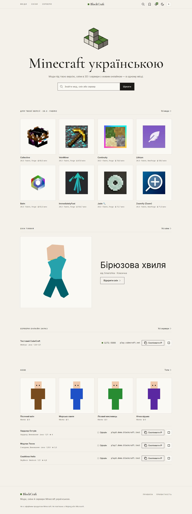
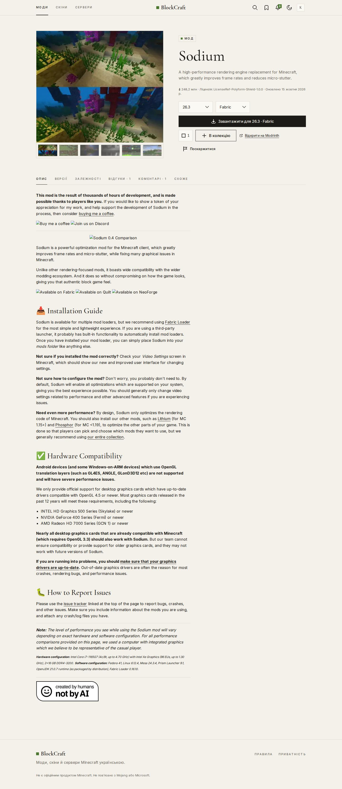
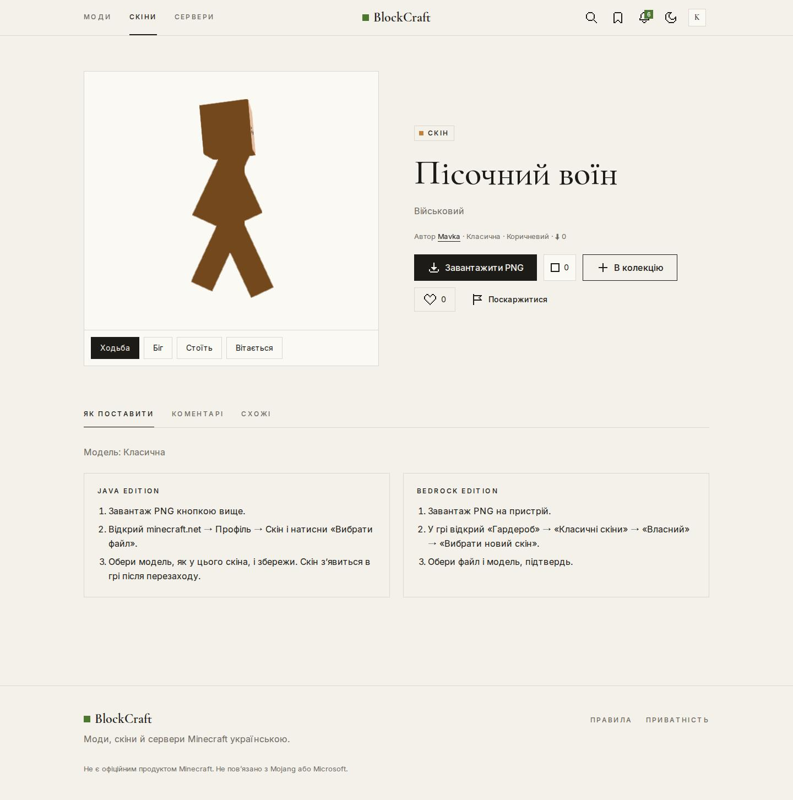
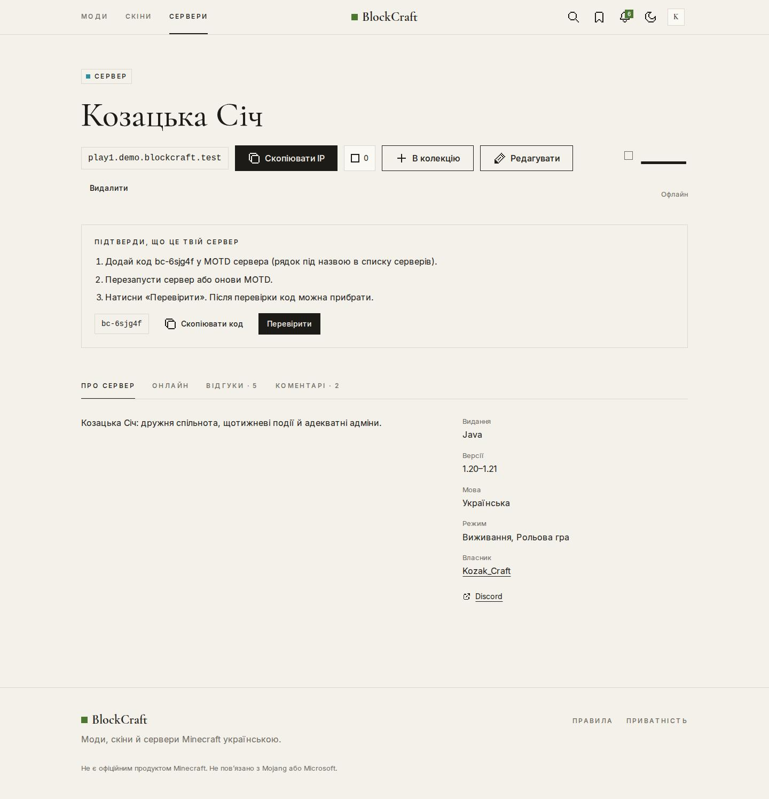
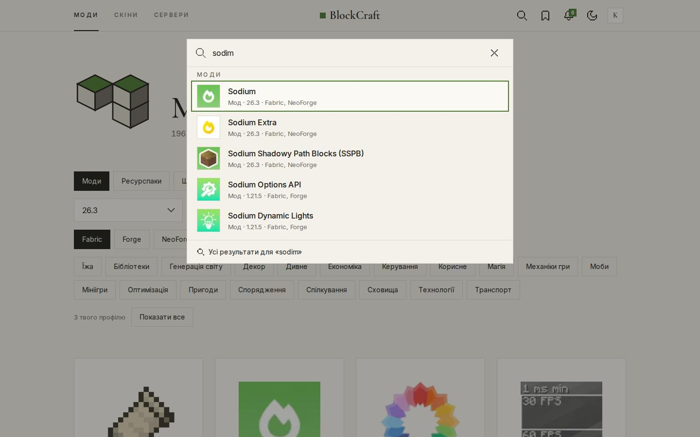
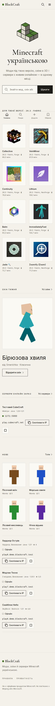

# Матеріали курсової роботи

**BlockCraft Ukraine** — україномовна платформа спільноти Minecraft: знайти моди, скіни й сервери → зберегти в обране й колекції → поділитися своїм.

| Матеріал | Файл |
| --- | --- |
| ER-діаграма бази даних | [er.md](er.md) (генерується: `make er-diagram`) |
| Діаграма варіантів використання | [use-cases.md](use-cases.md) |
| Діаграма компонентів і застосунки бекенду | [components.md](components.md) |
| Специфікація API (OpenAPI 3) | [openapi.yaml](openapi.yaml), інтерактивно — `/api/docs/` |
| Тестування й покриття | [testing.md](testing.md) |
| Скріншоти екранів | [screens/](screens/) |
| Технічна специфікація й етапи | [../tech.md](../tech.md) |
| Журнал рішень і відомі обмеження | [../PROGRESS.md](../PROGRESS.md) |
| Розгортання | [../deploy.md](../deploy.md) |

## Стек

Python 3.13, Django 5.2 + DRF, django-allauth (headless), Celery + beat, PostgreSQL 17, Redis 7, Meilisearch · Next.js 16 (App Router, Server Components), React 19, TypeScript strict, Tailwind CSS 4, TanStack Query, skinview3d · Docker Compose, Nginx, GitHub Actions.

## Що вміє MVP

- **Моди, ресурспаки, шейдери** з Modrinth: каталог із фільтрами за версією гри й лоадером, підбір правильного файлу, залежності, українські описи. Файли не перезаливаються — лише посилання.
- **Скіни:** завантаження з перевіркою PNG (64×64 і 64×32), визначення моделі й кольору, 2D-прев'ю, 3D-перегляд з анімаціями, пошук скіна за ніком через Mojang.
- **Сервери:** живий онлайн (пінг кожні 5 хв), графік за добу й тиждень, аптайм, підтвердження власності через MOTD, захист від SSRF.
- **Бібліотека:** обране, колекції (приватні, за посиланням, публічні, з редакторами), копіювання.
- **Спільнота:** відгуки зі зірками, лайки, коментарі з відповідями й закріпленням, рейтинг (байєсівське середнє) і тренди.
- **Пошук** з урахуванням опечаток («sodim» → Sodium), Ctrl+K, головна, топи.
- **Безпека й модерація:** модерація перших публікацій, скарги з автоприховуванням, санкції, фільтр лексики (UA / RU / EN), сповіщення, CSP, експорт і видалення даних, жодних приватних повідомлень.

## Скріншоти

| | |
| --- | --- |
|  |  |
| Головна | Мод: підбір файлу під версію |
|  |  |
| Скін у 3D | Сервер з онлайном |
|  |  |
| Пошук з опечаткою | Головна на телефоні |

Усі екрани — у [screens/](screens/): світла й темна теми, десктоп 1440 px і телефон 390 px.
