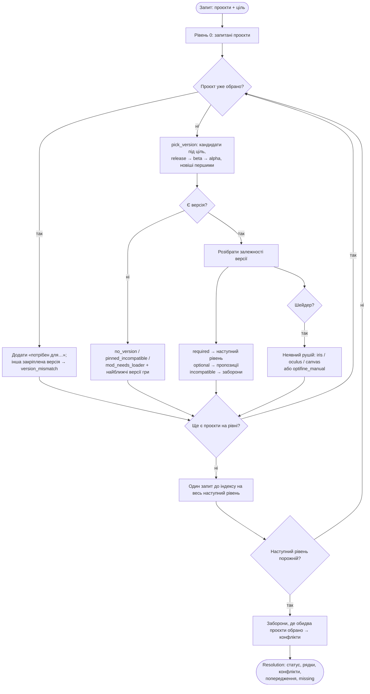

# Двигун сумісності модифікацій

Матеріал для розділу 3 пояснювальної записки («Реалізація»). Код — `backend/apps/compat/`, специфікація — `docs/tech.md`, розділ 9.

## 1. Постановка задачі

Гравець має **ціль** — пару «версія гри + лоадер», наприклад `1.21.1 · Fabric`. Він обирає один або кілька **проєктів**: моди, ресурспаки, шейдери, датапаки. Кожен проєкт на Modrinth має десятки чи сотні **версій-файлів**. Кожна версія вказує, для яких версій гри та лоадерів вона зібрана, і перелічує залежності чотирьох типів:

| Тип | Що означає | Що робить двигун |
| --- | --- | --- |
| `required` | без іншого проєкту не запуститься | додає його в результат з причиною «потрібен для …» |
| `optional` | інший проєкт розширює можливості | пропонує, але не додає |
| `incompatible` | разом з іншим проєктом гра ламається | позначає конфлікт, якщо обидва в результаті |
| `embedded` | інший проєкт уже вшито в файл | пропускає |

Треба знайти множину файлів, яка:

1. містить по одному файлу для кожного обраного проєкту та кожної його обов’язкової залежності (транзитивно);
2. кожен файл підходить під ціль;
3. не містить пар, які автори позначили несумісними;
4. для кожного рядка пояснює, **чому** він тут і що з ним не так.

Якщо повністю виконати умови неможливо, двигун не відмовляє. Він повертає найкращий частковий результат зі статусами й поясненнями. Саме цього бракує вебсайту Modrinth: там гравець сам перевіряє кожен файл.

## 2. Вхід і вихід

**Вхід:**
- `Target(game_version, loader)`;
- `requests: [(project, pinned_version_id?)]` — до 300 проєктів;
- `index` — джерело даних про проєкти. На кожному рівні обходу двигун звертається до нього **пачкою**: окремо за id проєктів, за id версій (коли залежність називає лише файл) і за slug (рушії шейдерів). Кожне звернення — два запити до бази, незалежно від кількості проєктів.

**Вихід — `Resolution`:**
- `items` — по рядку на проєкт: версія або `null`, причина (`requested` / `dependency` / `implicit`), хто цього потребує, статус (`ok`, `no_version`, `pinned_incompatible`, `mod_needs_loader`), найближчі версії гри з файлом;
- `conflicts` — пари `(a, b)` і хто заборонив;
- `suggestions` — необов’язкові залежності;
- `missing` — проєкти, яких ще немає в каталозі (їх імпортує викликач);
- `unavailable` — обов’язкові залежності, яких немає навіть на Modrinth (автор прибрав): це помилка, а не очікування;
- `warnings` — коди `beta_only`, `version_mismatch`, `optifine_manual`;
- загальний статус: `ok` → `warnings` → `errors` → `incomplete`.

Двигун **не повертає речень**. Тексти пояснень живуть на фронтенді, у файлі `features/compat/copy.ts`, і прив’язані до кодів. Так одна логіка обслуговує будь-яку мову інтерфейсу.

## 3. Знання про Minecraft (`rules.py`)

Правила винесено з алгоритму. Кожне має власний тест і звірене з реальними даними каталогу (1579 модів, 187 шейдерів, листопад 2026).

| Ціль | Які лоадери файлу приймаються для мода |
| --- | --- |
| Fabric | `fabric` |
| Quilt | `quilt`, `fabric` (Quilt завантажує моди Fabric) |
| Forge | `forge` |
| NeoForge | `neoforge`, а на 1.20.1 ще й `forge` (NeoForge відгалузився від Forge саме в цій версії) |
| Без модів (vanilla) | лише `datapack` — мод, що має файл-датапак (Terralith), інакше `mod_needs_loader` |

- Ресурспаки — файли з лоадером `minecraft` або `vanilla` (24 реальні версії ресурспаків мають саме `vanilla`).
- Датапаки — лише файли `datapack`.
- **Неявна залежність шейдерів.** Modrinth не записує, що шейдеру потрібен мод-рушій: у шейдерів залежностей немає зовсім. Без цього правила гравець завантажив би шейдер, який не запуститься. Тому:
  - Iris-шейдер на Fabric / Quilt / NeoForge → мод `iris`;
  - на Forge → мод `oculus`;
  - Canvas-шейдер на Fabric / Quilt → мод `canvas`;
  - шейдер лише для OptiFine → попередження `optifine_manual`, бо OptiFine немає на Modrinth.

## 4. Вибір версії `pick_version`

1. **Кандидати** — версії, де `game_versions ∋ target.game_version` і `loaders ∩ accepted(target, type) ≠ ∅`.
2. Якщо версію закріплено (`pinned`): вона серед кандидатів → беремо її; інакше статус `pinned_incompatible`.
3. Інакше сортуємо: спершу `release`, далі `beta`, далі `alpha`; у межах типу — новіші першими. Беремо першу.
4. Немає кандидатів → `no_version` і до трьох **найближчих версій гри**, для яких файл є. Сусідство рахуємо за порядком релізів: для цілі 26.1 і файлів під 1.20.1 / 1.21 / 1.21.1 відповідь — 1.21.1, 1.21, 1.20.1.

## 5. Розв’язання `resolve` — обхід у ширину по рівнях

```
level ← запитані проєкти (reason = requested)
chosen ← {}                       # проєкт → рядок результату
поки level не порожній:
    wanted ← {}; engines ← {}
    для (project, reason, required_by, pin) у level:
        якщо project у chosen:
            додати required_by до chosen[project]
            якщо pin ≠ обраній версії → warning version_mismatch
            продовжити
        pick ← pick_version(project, target, pin)
        якщо залежність закріплена на файл, що не підходить:
            pick ← pick_version(project, target) + warning version_mismatch
        chosen[project] ← рядок(pick)
        якщо pick.version — бета чи альфа → warning beta_only
        для dep у pick.version.dependencies:
            embedded     → пропустити
            optional     → suggestions
            incompatible → forbids += (project, dep)
            required     → wanted[dep] += (project, dep.version_id)
        якщо project — шейдер: rules.shader_engine(...) → engines або warning
    known ← index.projects(wanted)              # ОДИН запит на весь рівень
    implicit ← index.by_slug(engines)            # і один на рушії шейдерів
    невідомі → missing; відомі → наступний level
для (a, b) у forbids: якщо b у chosen → conflict(a, b, declared_by = a)
```



**Цикли** (A → B → A) не зависають: другий прихід до вже обраного проєкту лише дописує «потрібен для».

## 6. Складність

Позначимо: `P` — кількість проєктів у результаті, `V` — середня кількість версій проєкту, `D` — середня кількість залежностей версії, `L` — глибина дерева залежностей.

- Кожен проєкт обирається один раз: `pick_version` переглядає й сортує його версії, тобто `O(V log V)`.
- Кожна залежність обраної версії обробляється один раз: `O(P · D)`.
- Пошук конфліктів — `O(F)`, де `F` — кількість заборон (перевірка належності до словника `chosen` — `O(1)`).
- Разом **`O(P · (V log V + D))`** за часом і `O(P · V)` за пам’яттю (версії обраних проєктів).
- **Запити до бази:** `O(L)` замість `O(P)`. Індекс завантажує проєкти рівня й усі їхні версії двома запитами (до трьох пачок на рівень). На реальному прикладі (Complementary під Fabric: шейдер → Iris → Sodium) це три рівні. Кількість запитів росте з глибиною дерева, а не з кількістю проєктів. Тест `test_install_reads_a_fixed_number_of_queries` обмежує ланцюжок із шести проєктів 20 запитами на весь HTTP-запит. Готова відповідь для сторінки мода кешується в Redis на 10 хвилин.

## 7. Перевірка на реальних даних

| Запит | Результат двигуна |
| --- | --- |
| Sodium Extra, 1.21.1 · Fabric | Sodium Extra + **Sodium** («потрібен для Sodium Extra»); у пропозиціях — Reese’s Sodium Options, Iris Shaders і ще один проєкт, якого немає в нашому каталозі |
| Complementary Reimagined, 1.21.1 · Fabric | шейдер + **Iris** (неявно) + **Sodium** (залежність Iris) |
| Complementary Reimagined, 1.20.1 · Forge | шейдер + **Oculus** (неявно) + **Embeddium** (залежність Oculus) |
| Terralith, 1.21.1 · без модів | файл-датапак `Terralith_1.21_v2.5.8.zip`, а не `.jar` |
| Indium, 26.1 · Fabric | `no_version`; найближчі: 1.21.1, 1.21, 1.20.6 |
| LambDynamicLights + Sodium Dynamic Lights | конфлікт; заборонив автор LambDynamicLights |

## 8. Тестування

- `apps/compat/tests/test_resolver.py` — усі кейси 1–14 з розділу 9.6 `tech.md` (параметризовано), без бази й мережі, на індексі в пам’яті.
- `apps/compat/tests/test_api.py` — ендпоінти `GET /mods/{slug}/install` і `POST /compat/resolve`: права гостя, ліміт 300, невідомі проєкти, `incomplete` з одноразовим імпортом.
- Покриття `apps/compat` — 99–100 % (вимога — ≥ 95 %).
- Кейси 15–17 (перенесення збірки, ідентифікація файлів, експорт `.mrpack`) додаються разом зі збірками в етапі R4.

## 9. Обмеження

- **Дані автора — правда.** Якщо автор не вказав залежність чи несумісність, двигун про неї не знає. Він не аналізує вміст `.jar`.
- **Діапазони версій залежностей.** Modrinth записує залежність на проєкт, а не на діапазон версій (`version_id` закріплює лише одну версію). Тому «Sodium ≥ 0.6» двигун не перевіряє. Він бере найсвіжішу сумісну з ціллю версію, і на практиці це збігається з очікуваннями авторів.
- **Одна версія на проєкт.** Якщо дві залежності вимагають різних закріплених версій одного проєкту, лишається перша, а друга дає `version_mismatch`. Повний розв’язувач обмежень (SAT, як у пакетних менеджерах) тут надлишковий: у даних Modrinth закріплення трапляються майже лише в модпаках.
- **Неявні правила обмежено шейдерами.** Інші неявні вимоги (наприклад, «моду на Forge потрібен Forgified Fabric API для портів з Fabric») не моделюються.
- **Каталог неповний.** Залежності, яких немає в каталозі, повертаються в `missing` і імпортуються у фоні. Поки імпорт не завершиться, результат має статус `incomplete`: сторінка питає сервер кожні 4 с (до хвилини) і перемальовується, щойно відповідь повна. Залежність, якої немає й на Modrinth, на добу позначається недоступною і показується як помилка.
