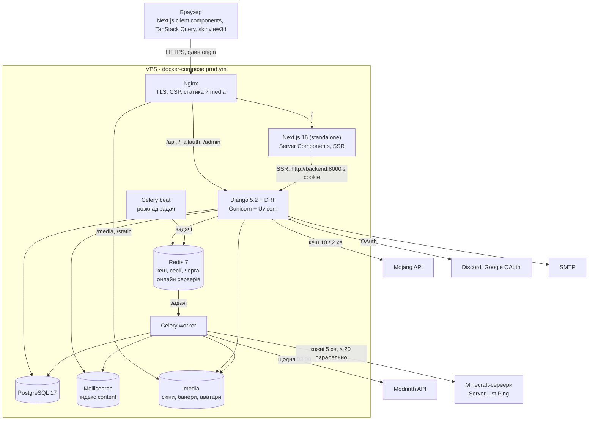

# Діаграма компонентів

## Застосунки бекенду

| Застосунок | Відповідає за | Зовнішнє |
| --- | --- | --- |
| `core` | Kinds-реєстр, міксини моделей, лічильники, публікація, помилки API, транслітерація, кеш для гостей | — |
| `accounts` | Користувач, профіль гри, налаштування, експорт і видалення даних | allauth (email, Discord, Google) |
| `mods` | Каталог Modrinth, версії, підбір файлу, переклади описів | Modrinth (Celery) |
| `skins` | Перевірка PNG, модель slim/classic, колір, 2D-прев'ю, пошук за ніком | Mojang (з кешем) |
| `servers` | Сервери, пінг, статус у Redis, статистика, верифікація MOTD, SSRF-захист | Minecraft-сервери (Celery) |
| `library` | Обране, колекції, редактори, посилання з токеном, завантаження | — |
| `social` | Лайки, відгуки, коментарі, рейтинг і тренди | — |
| `search` | Документи, індексація через сигнали, пошук із запасним варіантом у БД | Meilisearch |
| `home` | Головна, топи, демо-дані (`make seed`) | — |
| `moderation` | Скарги, автоприховування, санкції, фільтр лексики | — |
| `notifications` | Сповіщення й лічильник непрочитаних | — |

## Шари всередині застосунку

`models` (лише поля) → `services` (усі зміни стану, транзакції) → `selectors` (складне читання, анотації без N+1) → `serializers` → `views` (тонкі) → `urls`. Зовнішні API — у `clients.py`, фонові задачі — у `tasks.py`.
