# ER-діаграма

Згенеровано командою `make er-diagram` (`manage.py er_diagram`) з моделей Django; GitHub показує її як діаграму. `ANY_KIND` — узагальнений зв'язок `content_type + object_id` з kinds-реєстру (мод, скін, сервер, колекція).

```mermaid
erDiagram
    User {
        bigint id PK
        varchar password
        timestamp last_login
        bool is_superuser
        bool is_staff
        bool is_active
        timestamp date_joined
        varchar email
        varchar nickname
        file avatar
        varchar bio
        varchar mc_nickname
        varchar role
        int xp
        smallint level
        bool is_private
        int published_count
    }
    GameProfile {
        bigint user PK
        varchar game_version
        varchar loader
        varchar edition
        array interests
        bool onboarding_done
    }
    UserSettings {
        bigint user PK
        varchar theme
        varchar language
        json notify_prefs
        bool history_enabled
        varchar who_can_comment
        bool collections_visible
    }
    Favorite {
        bigint id PK
        int content_type FK
        bigint user FK
        timestamp created_at
    }
    Collection {
        bigint id PK
        timestamp created_at
        timestamp updated_at
        int likes_count
        int favorites_count
        int comments_count
        int downloads_count
        int views_count
        float rating_avg
        int rating_count
        float score
        float trend_score
        bigint owner FK
        varchar title
        varchar description
        varchar visibility
        varchar share_token
        bool is_setup
        bigint copied_from FK
        int items_count
    }
    CollectionItem {
        bigint id PK
        int content_type FK
        bigint collection FK
        int position
        varchar slot
        varchar note
        bigint added_by FK
        timestamp created_at
    }
    Download {
        bigint id PK
        bigint user FK
        bigint project FK
        bigint version FK
        varchar game_version
        varchar loader
        timestamp created_at
    }
    Like {
        bigint id PK
        int content_type FK
        bigint user FK
        timestamp created_at
    }
    Review {
        bigint id PK
        timestamp created_at
        timestamp updated_at
        int content_type FK
        bigint user FK
        smallint stars
        text text
        int helpful_count
        varchar status
    }
    ReviewVote {
        bigint id PK
        bigint user FK
        bigint review FK
        bool is_helpful
        timestamp created_at
    }
    Comment {
        bigint id PK
        timestamp created_at
        timestamp updated_at
        varchar status
        varchar rejection_reason
        timestamp published_at
        int content_type FK
        bigint user FK
        bigint parent FK
        text body
        bool is_pinned
        bool is_deleted
    }
    Category {
        bigint id PK
        varchar slug
        varchar name_uk
        varchar project_type
        varchar header
    }
    Project {
        bigint id PK
        timestamp created_at
        timestamp updated_at
        varchar status
        varchar rejection_reason
        timestamp published_at
        int likes_count
        int favorites_count
        int comments_count
        int downloads_count
        int views_count
        float rating_avg
        int rating_count
        float score
        float trend_score
        varchar modrinth_id
        varchar slug
        varchar project_type
        varchar title
        varchar summary
        varchar summary_uk
        text body_md
        text body_html
        varchar icon_url
        json gallery
        array loaders
        array game_versions
        varchar license
        varchar source_url
        bigint modrinth_downloads
        timestamp modrinth_updated_at
        varchar gpu_load
        bool gpu_load_manual
        bigint claimed_by FK
        bigint suggested_by FK
        timestamp synced_at
    }
    ProjectVersion {
        bigint id PK
        bigint project FK
        varchar modrinth_version_id
        varchar name
        varchar version_number
        varchar version_type
        array game_versions
        array loaders
        varchar file_url
        varchar file_name
        bigint file_size
        varchar sha1
        json dependencies
        timestamp released_at
    }
    Skin {
        bigint id PK
        timestamp created_at
        timestamp updated_at
        bigint author FK
        varchar status
        varchar rejection_reason
        timestamp published_at
        int likes_count
        int favorites_count
        int comments_count
        int downloads_count
        int views_count
        float rating_avg
        int rating_count
        float score
        float trend_score
        varchar title
        file file
        file preview
        varchar model
        varchar dominant_color
        varchar color_bucket
        array style_tags
        varchar source
        bigint parent FK
        varchar texture_hash
        bool is_current
    }
    Server {
        bigint id PK
        timestamp created_at
        timestamp updated_at
        bigint author FK
        varchar status
        varchar rejection_reason
        timestamp published_at
        int likes_count
        int favorites_count
        int comments_count
        int downloads_count
        int views_count
        float rating_avg
        int rating_count
        float score
        float trend_score
        varchar name
        varchar slug
        varchar host
        int port
        varchar edition
        array modes
        varchar versions_label
        varchar language
        text description
        file banner
        varchar discord_url
        varchar website_url
        bool has_whitelist
        bool is_verified
        varchar verify_code
        timestamp last_online_at
        int ip_copies_count
    }
    ServerSnapshot {
        bigint id PK
        bigint server FK
        timestamp ts
        bool is_online
        int players_online
        int players_max
        int latency_ms
        varchar version_name
    }
    Notification {
        bigint id PK
        bigint user FK
        varchar type
        json payload
        bool is_read
        timestamp created_at
    }
    Report {
        bigint id PK
        int content_type FK
        bigint reporter FK
        varchar reason
        varchar comment
        varchar status
        bool auto_hidden
        bigint handled_by FK
        timestamp handled_at
        timestamp created_at
    }
    Sanction {
        bigint id PK
        bigint user FK
        varchar type
        timestamp until
        varchar reason
        bigint issued_by FK
        timestamp created_at
    }
    BannedWord {
        bigint id PK
        varchar word
        varchar language
        bool is_root
    }
    ANY_KIND {
        string kind "mod, skin, server, collection"
    }
    Collection }o--o{ User : "editors"
    Collection }o--|| Collection : "copied_from"
    Collection }o--|| User : "owner"
    CollectionItem }o--|| ANY_KIND : "content_type + object_id"
    CollectionItem }o--|| Collection : "collection"
    CollectionItem }o--|| User : "added_by"
    Comment }o--|| ANY_KIND : "content_type + object_id"
    Comment }o--|| Comment : "parent"
    Comment }o--|| User : "user"
    Download }o--|| Project : "project"
    Download }o--|| ProjectVersion : "version"
    Download }o--|| User : "user"
    Favorite }o--|| ANY_KIND : "content_type + object_id"
    Favorite }o--|| User : "user"
    GameProfile ||--|| User : "user"
    Like }o--|| ANY_KIND : "content_type + object_id"
    Like }o--|| User : "user"
    Notification }o--|| User : "user"
    Project }o--o{ Category : "categories"
    Project }o--|| User : "claimed_by"
    Project }o--|| User : "suggested_by"
    ProjectVersion }o--|| Project : "project"
    Report }o--|| ANY_KIND : "content_type + object_id"
    Report }o--|| User : "handled_by"
    Report }o--|| User : "reporter"
    Review }o--|| ANY_KIND : "content_type + object_id"
    Review }o--|| User : "user"
    ReviewVote }o--|| Review : "review"
    ReviewVote }o--|| User : "user"
    Sanction }o--|| User : "issued_by"
    Sanction }o--|| User : "user"
    Server }o--|| User : "author"
    ServerSnapshot }o--|| Server : "server"
    Skin }o--|| Skin : "parent"
    Skin }o--|| User : "author"
    UserSettings ||--|| User : "user"

```

