# ER-діаграма

Згенеровано командою `make er-diagram` (`backend/apps/core/management/commands/er_diagram.py`) з моделей Django. Зв'язки `content_type + object_id` (обране, відгуки, скарги, переклади, «взяв») показано як зв'язок з `object` — будь-яким зареєстрованим типом контенту (`apps/core/kinds.py`).

```mermaid
erDiagram
    User {
        bigint id PK
        varchar password
        timestamp last_login
        bool is_superuser
        bool is_staff
        bool is_active
        timestamp date_joined
        varchar email
        varchar nickname
        file avatar
        varchar bio
        varchar mc_nickname
        varchar role
        bool is_private
    }
    GameProfile {
        bigint user PK
        bigint game_version FK
        varchar loader
        varchar edition
        bool onboarding_done
    }
    UserSettings {
        bigint user PK
        varchar theme
        varchar language
        json notify_prefs
        bool history_enabled
        bool collections_visible
        bigint skin FK
    }
    SyncRun {
        bigint id PK
        varchar source
        varchar job
        varchar status
        timestamp started_at
        timestamp finished_at
        int created
        int updated
        int unchanged
        int skipped
        int failed
        json errors
        json params
    }
    GameVersion {
        varchar version PK
        varchar version_type
        timestamp released_at
        bool is_major
        bool is_supported
    }
    Favorite {
        bigint id PK
        int content_type FK
        bigint user FK
        timestamp created_at
    }
    Collection {
        bigint id PK
        timestamp created_at
        timestamp updated_at
        int favorites_count
        int downloads_count
        float rating_avg
        int rating_count
        float score
        float trend_score
        bigint owner FK
        varchar title
        varchar description
        varchar visibility
        varchar share_token
        bigint copied_from FK
        int items_count
    }
    CollectionItem {
        bigint id PK
        int content_type FK
        bigint collection FK
        int position
        varchar note
        bigint added_by FK
        timestamp created_at
    }
    Download {
        bigint id PK
        bigint user FK
        int content_type FK
        varchar action
        bigint project FK
        bigint version FK
        varchar game_version
        varchar loader
        timestamp created_at
    }
    Review {
        bigint id PK
        timestamp created_at
        timestamp updated_at
        int content_type FK
        bigint user FK
        smallint stars
        text text
        int helpful_count
        text reply_text
        bigint reply_by FK
        timestamp replied_at
        varchar status
    }
    ReviewVote {
        bigint id PK
        bigint user FK
        bigint review FK
        bool is_helpful
        timestamp created_at
    }
    Category {
        bigint id PK
        varchar slug
        varchar name_uk
        varchar project_type
        varchar header
    }
    Project {
        bigint id PK
        timestamp created_at
        timestamp updated_at
        varchar source
        varchar external_id
        varchar external_url
        timestamp synced_at
        bool is_hidden
        varchar hidden_reason
        int favorites_count
        int downloads_count
        float rating_avg
        int rating_count
        float score
        float trend_score
        varchar slug
        varchar project_type
        varchar title
        varchar summary
        varchar summary_uk
        bigint summary_uk_by FK
        text body_uk_html
        bigint body_uk_by FK
        text body_html
        varchar icon_url
        json gallery
        array loaders
        array game_versions
        varchar client_side
        varchar server_side
        varchar license
        varchar source_url
        bigint modrinth_downloads
        int modrinth_follows
        timestamp published_at
        timestamp modrinth_updated_at
        timestamp versions_synced_at
        varchar gpu_load
        bool gpu_load_manual
        bigint imported_by FK
    }
    ProjectVersion {
        bigint id PK
        bigint project FK
        varchar modrinth_version_id
        varchar name
        varchar version_number
        varchar version_type
        array game_versions
        array loaders
        timestamp date_published
        varchar file_url
        varchar file_name
        bigint file_size
        varchar sha1
        varchar sha512
        json dependencies
    }
    Skin {
        bigint id PK
        timestamp created_at
        timestamp updated_at
        varchar source
        varchar external_id
        varchar external_url
        timestamp synced_at
        bool is_hidden
        varchar hidden_reason
        int favorites_count
        int downloads_count
        float rating_avg
        int rating_count
        float score
        float trend_score
        varchar title
        file texture
        varchar texture_url
        varchar texture_hash
        file preview
        varchar model
        varchar dominant_color
        varchar color_bucket
        varchar player_name
        int source_views
        bigint added_by FK
    }
    Server {
        bigint id PK
        timestamp created_at
        timestamp updated_at
        varchar source
        varchar external_id
        varchar external_url
        timestamp synced_at
        bool is_hidden
        varchar hidden_reason
        int favorites_count
        int downloads_count
        float rating_avg
        int rating_count
        float score
        float trend_score
        varchar name
        varchar slug
        varchar java_host
        int java_port
        varchar bedrock_host
        int bedrock_port
        varchar country
        array languages
        array categories
        varchar content_kind
        array supported_versions
        varchar recommended_version
        bigint required_pack FK
        varchar modpack_project_id
        varchar modpack_version_id
        varchar summary
        varchar summary_uk
        bigint summary_uk_by FK
        text body_uk_html
        bigint body_uk_by FK
        text description_html
        text description_uk_md
        text description_uk_html
        varchar icon_url
        varchar banner_url
        varchar discord_url
        varchar website_url
        bigint owner FK
        bigint claimant FK
        timestamp claimed_at
        bool is_verified
        bool pack_chosen_by_owner
        timestamp last_online_at
        int modrinth_plays
        int ip_copies_count
    }
    ServerSnapshot {
        bigint id PK
        bigint server FK
        timestamp ts
        bool is_online
        int players_online
        int players_max
        int latency_ms
        varchar version_name
    }
    Pack {
        bigint id PK
        timestamp created_at
        timestamp updated_at
        bigint author FK
        varchar status
        varchar rejection_reason
        timestamp published_at
        int favorites_count
        int downloads_count
        float rating_avg
        int rating_count
        float score
        float trend_score
        varchar origin
        varchar title
        varchar slug
        file cover
        varchar summary
        varchar summary_uk
        bigint summary_uk_by FK
        text body_uk_html
        bigint body_uk_by FK
        text description_html
        varchar game_version
        varchar loader
        varchar loader_version
        int items_count
        varchar compat_status
        timestamp compat_checked_at
        json compat_report
        varchar visibility
        varchar share_token
        smallint ram_min_gb
        text notes_md
        text notes_html
        bigint forked_from FK
        int forks_count
        varchar external_id
        varchar external_url
        varchar modrinth_version_id
        varchar icon_url
        varchar source_file_url
        bigint modrinth_downloads
        timestamp synced_at
    }
    PackItem {
        bigint id PK
        bigint pack FK
        bigint project FK
        bigint version FK
        varchar reason
        array required_by
        varchar env_client
        varchar env_server
        int position
    }
    PackExternalFile {
        bigint id PK
        bigint pack FK
        varchar path
        varchar url
        varchar sha1
        varchar sha512
        bigint size
    }
    LoaderRelease {
        bigint id PK
        varchar loader
        varchar game_version
        varchar version
        timestamp updated_at
    }
    Notification {
        bigint id PK
        bigint user FK
        varchar type
        json payload
        bool is_read
        timestamp created_at
    }
    Report {
        bigint id PK
        int content_type FK
        bigint reporter FK
        varchar reason
        varchar comment
        varchar status
        bool auto_hidden
        bigint handled_by FK
        timestamp handled_at
        timestamp created_at
    }
    Sanction {
        bigint id PK
        bigint user FK
        varchar type
        timestamp until
        varchar reason
        bigint issued_by FK
        timestamp created_at
    }
    BannedWord {
        bigint id PK
        varchar word
        varchar language
        bool is_root
    }
    Translation {
        bigint id PK
        timestamp created_at
        timestamp updated_at
        bigint author FK
        int content_type FK
        varchar field
        text text
        varchar status
        bigint reviewed_by FK
        timestamp reviewed_at
        varchar reject_reason
    }
    ANY_KIND {
        string kind "mod, skin, server, collection"
    }
    Collection }o--o{ User : "editors"
    Collection }o--|| Collection : "copied_from"
    Collection }o--|| User : "owner"
    CollectionItem }o--|| ANY_KIND : "content_type + object_id"
    CollectionItem }o--|| Collection : "collection"
    CollectionItem }o--|| User : "added_by"
    Download }o--|| ANY_KIND : "content_type + object_id"
    Download }o--|| Project : "project"
    Download }o--|| ProjectVersion : "version"
    Download }o--|| User : "user"
    Favorite }o--|| ANY_KIND : "content_type + object_id"
    Favorite }o--|| User : "user"
    GameProfile ||--|| User : "user"
    GameProfile }o--|| GameVersion : "game_version"
    Notification }o--|| User : "user"
    Pack }o--|| Pack : "forked_from"
    Pack }o--|| User : "author"
    Pack }o--|| User : "body_uk_by"
    Pack }o--|| User : "summary_uk_by"
    PackExternalFile }o--|| Pack : "pack"
    PackItem }o--|| Pack : "pack"
    PackItem }o--|| Project : "project"
    PackItem }o--|| ProjectVersion : "version"
    Project }o--o{ Category : "categories"
    Project }o--|| User : "body_uk_by"
    Project }o--|| User : "imported_by"
    Project }o--|| User : "summary_uk_by"
    ProjectVersion }o--|| Project : "project"
    Report }o--|| ANY_KIND : "content_type + object_id"
    Report }o--|| User : "handled_by"
    Report }o--|| User : "reporter"
    Review }o--|| ANY_KIND : "content_type + object_id"
    Review }o--|| User : "reply_by"
    Review }o--|| User : "user"
    ReviewVote }o--|| Review : "review"
    ReviewVote }o--|| User : "user"
    Sanction }o--|| User : "issued_by"
    Sanction }o--|| User : "user"
    Server }o--|| Pack : "required_pack"
    Server }o--|| User : "body_uk_by"
    Server }o--|| User : "claimant"
    Server }o--|| User : "owner"
    Server }o--|| User : "summary_uk_by"
    ServerSnapshot }o--|| Server : "server"
    Skin }o--|| User : "added_by"
    Translation }o--|| ANY_KIND : "content_type + object_id"
    Translation }o--|| User : "author"
    Translation }o--|| User : "reviewed_by"
    UserSettings ||--|| User : "user"
    UserSettings }o--|| Skin : "skin"

```

