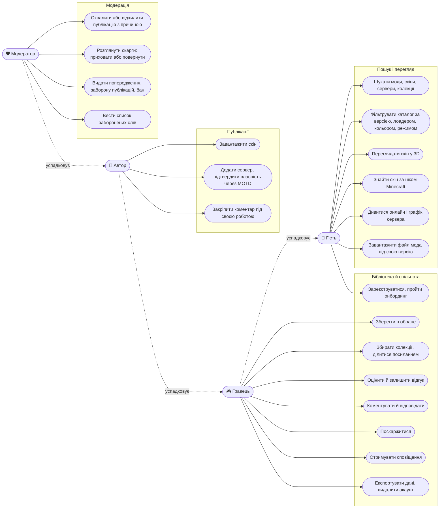

# Діаграма варіантів використання

Чотири ролі: кожна наступна має все, що попередня. Модератор працює в Django admin.

| Роль | Хто це | Обмеження |
| --- | --- | --- |
| Гість | Будь-хто без входу | Лише читання; дії з бібліотекою відкривають «Увійди, щоб не загубити» з поверненням до дії |
| Гравець | Зареєстрований користувач | Тротлінг на коментарі, відгуки, скарги; свої роботи не оцінює й не скаржиться на них |
| Автор | Гравець із публікаціями | Перші 3 роботи — на модерації; після 3 схвалених — роль «довірений автор», публікації одразу |
| Модератор | `role = moderator / admin` | Django admin: черги публікацій і скарг, санкції, словник |
